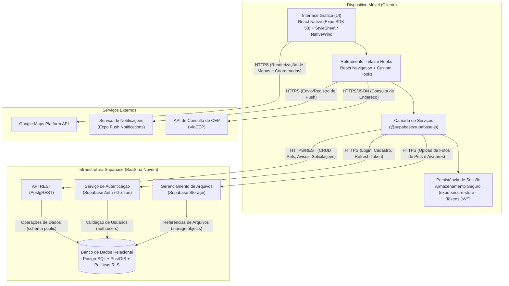

# 🐾 ConectaPet

**Aplicativo mobile de adoção responsável que conecta animais resgatados a adotantes compatíveis por meio de um algoritmo de Match comportamental.**


</div>

---

## Sobre o Projeto

O **ConectaPet** nasceu no âmbito da disciplina extensionista *Laboratório de Programação para Dispositivos Móveis* da **Univates**, com o propósito de levar soluções tecnológicas móveis a instituições do **Vale do Taquari (RS)** que não dispõem de recursos próprios para desenvolver sistemas sob medida.

O projeto foi concebido e validado em parceria com a **APAAM (Associação de Proteção dos Animais Arroio-meenses)**, ONG sem fins lucrativos localizada em **Arroio do Meio - RS** e mantida exclusivamente por voluntários, que acolhe, trata e intermedia a adoção de cães e gatos abandonados ou vítimas de maus-tratos.

A instituição enfrenta o desafio constante de dar visibilidade aos animais abrigados — muitos aguardando por um lar há anos — e, ao mesmo tempo, garantir adoções responsáveis, alinhando o perfil de cada animal às condições de espaço, financeiras e de cuidado de cada adotante. O **ConectaPet** resolve essa dor ao centralizar:

- **Recomendação inteligente (Match comportamental):** ordena os animais conforme a compatibilidade com o perfil preenchido pelo adotante.
- **Aproximação com a ONG:** apresenta a história da instituição, localização interativa no mapa, feed de campanhas/avisos e início rápido de adoção via WhatsApp.
- **Facilitação de doações:** disponibiliza canais diretos de apoio financeiro via Pix e QR Code para auxiliar na manutenção da ONG e na compra de ração.

---

## Funcionalidades Principais

### Para Adotantes

- **Autenticação e Conta Segura:** cadastro sequencial de dados pessoais, autenticação por e-mail e senha criptografada, persistência segura de sessão e botão dedicado de logout com limpeza de token local.
- **Match Comportamental (Listagem Inteligente):** algoritmo que ordena o catálogo de pets de acordo com a afinidade em relação às preferências e características cadastradas pelo adotante (exibindo por ordem de inclusão enquanto o perfil não estiver completo).
- **Hub de Perfil e Barra de Progresso:** menu organizado em três abas (*Dados Pessoais*, *Endereço* e *Match*), com indicador visual de porcentagem de conclusão do cadastro, upload de avatar com recorte (*crop*) e campo opcional de Instagram para auxiliar a triagem pelas voluntárias.
- **Busca Inteligente de Endereço:** autopreenchimento de logradouro, cidade e estado via integração com a API **ViaCEP**, mantendo Cidade e Estado bloqueados para edição após a consulta para preservar a integridade dos dados.
- **Filtros, Pesquisa e Feed de Avisos:** filtros rápidos por categoria (*cachorro*, *gato*, *outros* e *todos*), busca textual por nome do pet ou da ONG e carrossel superior com avisos, notícias e campanhas de adoção com links de redirecionamento.
- **Mapa Interativo e Exploração de ONGs:** listagem de instituições ordenada por proximidade geográfica, mapa via **Google Maps** centralizado na ONG mais próxima e botão **Expandir** para navegação em tela cheia com controles de zoom e centralização.
- **Detalhes do Pet e Adoção via WhatsApp:** visualização das características físicas, saúde e perfil comportamental do animal, localização da ONG, guia passo a passo para adoção e botão **"Iniciar a Adoção por Whatsapp"**, que abre o aplicativo com uma mensagem pré-preenchida contendo os dados do pet e do adotante.
- **Doações via Pix e QR Code:** subseção na página da ONG com exibição de QR Code da chave Pix, opção para copiar a chave para a área de transferência e atalho para copiar a chave com redirecionamento direto para o aplicativo bancário instalado no dispositivo.

### Para Voluntários da ONG

- **Painel de Manutenção Restrito:** controle de acesso por papel de usuário que habilita a aba dedicada *Manutenção* na barra de navegação inferior exclusivamente para perfis voluntários ou superiores.
- **Gestão Completa de Pets (CRUD) com Vínculo Automático:** cadastro progressivo em 4 etapas, listagem, edição e exclusão individual de animais, associando automaticamente cada novo registro à ONG do voluntário autenticado.
- **Recorte e Ajuste de Imagens (Crop):** interface nativa de corte e enquadramento ao selecionar fotos da galeria antes do envio para a nuvem.
- **Gestão do Feed de Avisos:** criação e gerenciamento de comunicados e campanhas no feed da tela inicial com imagem, título, descrição e link de redirecionamento.

---

## Arquitetura e Segurança

O **ConectaPet** adota uma arquitetura baseada em **BaaS (Backend-as-a-Service)** com **Supabase**, eliminando a necessidade de um servidor back-end intermediário dedicado. O aplicativo mobile em **React Native (Expo SDK 58)** comunica-se via HTTPS diretamente com os serviços do Supabase (API REST via PostgREST, autenticação via GoTrue e armazenamento de mídias via Storage) sobre um banco relacional **PostgreSQL + PostGIS**, além de integrar-se a APIs externas para geolocalização, consulta de CEP e notificações.



### Pilares de Segurança e Qualidade

- **Conformidade com a LGPD via Row Level Security (RLS):** dados sensíveis dos adotantes (CPF, endereço, telefone e perfil socioeconômico) são protegidos diretamente na camada de banco de dados PostgreSQL, restringindo leitura e escrita ao próprio titular ou a voluntários/administradores autorizados da ONG.
- **Autenticação e Armazenamento Seguro de JWT:** senhas nunca são armazenadas em texto puro, utilizando hash criptográfico gerenciado pelo Supabase Auth (`bcrypt`), enquanto os tokens JWT de sessão são persistidos no Keystore do dispositivo por meio do `expo-secure-store`.
- **Integridade Binária, Compressão e Cache de Mídias:** as imagens selecionadas são processadas de forma assíncrona em memória para garantir conversão em bytes reais (evitando arquivos corrompidos ou truncados de 0 bytes), passam por compressão/redimensionamento no upload ao Supabase Storage e contam com cache local para reduzir o consumo de dados.
- **Tolerância a Falhas de Rede e Ergonomia:** exceções de conexão ou ausência de internet são tratadas sem travamentos (*crashes*), exibindo feedback visual amigável e preservando dados de formulários em andamento. A interface segue boas práticas de acessibilidade (áreas de toque mínimas de `48x48 dp`, compatibilidade com Android 8.0+ e respeito dinâmico às *Safe Area Insets*).

### Estrutura do Banco de Dados

O banco relacional em **PostgreSQL** (com extensão geoespacial **PostGIS**) é composto por **14 tabelas principais** que sustentam o domínio da aplicação: `countries`, `states`, `cities`, `addresses`, `profiles`, `housing_types`, `adopter_preferences`, `ongs`, `ong_roles_types`, `ong_members`, `announcements`, `animals`, `animals_preferences` e `animal_photos`.

---

## Tecnologias Utilizadas

| Categoria | Tecnologias |
| :--- | :--- |
| **Front-end Mobile** | React Native, TypeScript, Expo (SDK 58), Expo Router / React Navigation, StyleSheet / NativeWind, `expo-secure-store` |
| **Back-end & Banco de Dados** | Supabase (BaaS), `@supabase/supabase-js`, PostgreSQL (SQL + Políticas RLS), PostGIS, PostgREST, Supabase Auth (GoTrue), Supabase Storage |
| **APIs e Serviços Externos** | Google Maps Platform API, ViaCEP, Expo Push Notifications |
| **Ferramentas e Versionamento** | Node.js, npm, Expo Go, Visual Studio Code (VS Code), Git, GitHub |

---

## Pré-requisitos e Como Executar Localmente

### Pré-requisitos

- **Node.js** e **npm** instalados na máquina
- **Git** instalado
- Aplicativo **Expo Go** instalado em um dispositivo físico (Android 8.0 Oreo ou superior / iOS)
- Projeto configurado no **Supabase** (com esquema das tabelas e políticas RLS aplicadas) e chave ativa da **Google Maps Platform API**

### Passo a Passo

1. **Clone o repositório:**

```bash
git clone [URL_DO_REPOSITORIO]
cd [NOME_DA_PASTA_DO_PROJETO]
```

2. **Instale as dependências:**

```bash
npm install
```

3. **Configure as variáveis de ambiente:**

Crie um arquivo `.env` na raiz do projeto utilizando o modelo abaixo como referência:

```env
# .env.example
# Ajuste os nomes exatos das chaves caso o projeto utilize um prefixo específico

# Supabase
EXPO_PUBLIC_SUPABASE_URL=[URL_DO_PROJETO_SUPABASE]
EXPO_PUBLIC_SUPABASE_ANON_KEY=[CHAVE_ANON_PUBLICA_SUPABASE]

# Google Maps Platform
EXPO_PUBLIC_GOOGLE_MAPS_API_KEY=[CHAVE_API_GOOGLE_MAPS]
```

4. **Inicie o servidor de desenvolvimento do Expo:**

```bash
npx expo start
```

5. **Execute no dispositivo:**

Escaneie o QR Code exibido no terminal utilizando o aplicativo **Expo Go** (certifique-se de que o dispositivo móvel e o computador estejam na mesma rede).

---

## Roadmap e Evolução

O **MVP do ConectaPet** foi concluído ao longo de **4 sprints** (Sprint 1 a Sprint Final), com entregas incrementais e validação direta junto às voluntárias da **APAAM**. Os feedbacks coletados em reunião com a ONG foram incorporados já na entrega final do MVP — incluindo o cadastro real da história e dados da instituição, o campo de Instagram no perfil do adotante para triagem e o fluxo de adoção assistida via WhatsApp.

### Entregues no MVP

- [x] Autenticação segura (cadastro, login, hash de credenciais, persistência de JWT via `expo-secure-store` e logout)
- [x] Controle de acesso por papéis (*Adotante* e *Voluntário da ONG*) e políticas RLS (LGPD) no PostgreSQL
- [x] Modelagem relacional completa (14 tabelas) com registro dos dados reais e história da APAAM
- [x] Hub de perfil modular com barra de progresso, campo de Instagram, recorte de avatar e preenchimento de endereço via ViaCEP
- [x] Listagem inteligente de pets ordenada por algoritmo de Match comportamental, com filtros por espécie e busca textual
- [x] Tela de detalhes do pet com guia passo a passo e redirecionamento para adoção via WhatsApp com mensagem pré-preenchida
- [x] Módulo de ONGs com listagem por proximidade, mapas interativos (Google Maps) com expansão em tela cheia, redes sociais e doações via Pix / QR Code
- [x] Painel de manutenção para voluntários com CRUD completo de pets (vínculo automático à ONG), recorte/compressão de imagens e gestão do feed de avisos

### Em Andamento e Próximas Fases

- [ ] Aprovação final do disparo de notificações Push para eventos cadastrados no feed *(em aprovação)*
- [ ] Publicação do aplicativo na **Google Play Store** *(levantamento de requisitos em andamento)*
- [ ] **Módulo Pet Care:** histórico de saúde e controle de vacinas do animal
- [ ] **Lembretes de vacinação:** notificações push automáticas para acompanhamento pós-adoção
- [ ] **Painel de estatísticas:** dashboard e relatórios de métricas para gestão da ONG
- [ ] **Gamificação:** sistema de conquistas e metas de incentivo aos adotantes

---

## Agradecimentos

- À **APAAM (Associação de Proteção dos Animais Arroio-meenses)** e suas voluntárias, pela abertura, parceria e contribuições essenciais no levantamento de necessidades e validação do aplicativo.
